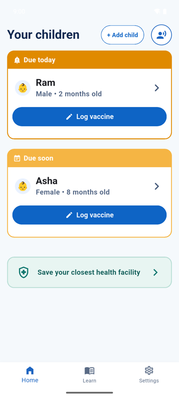
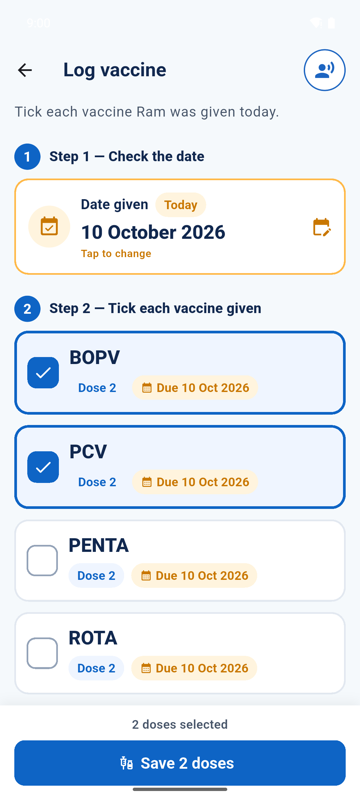
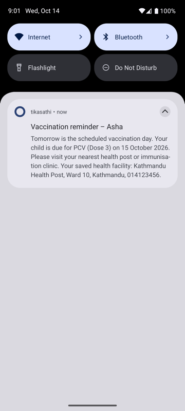
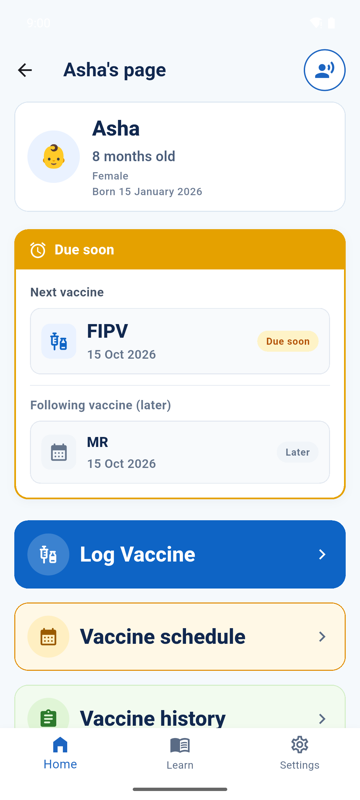
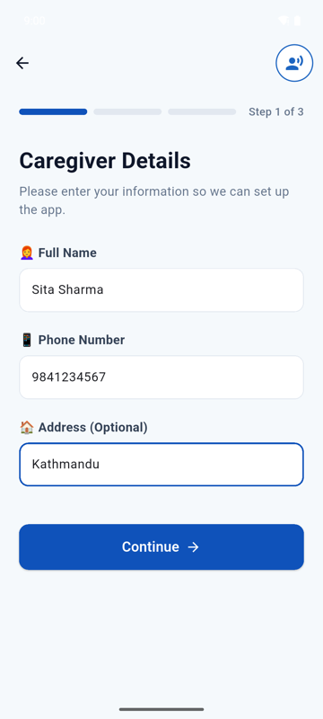
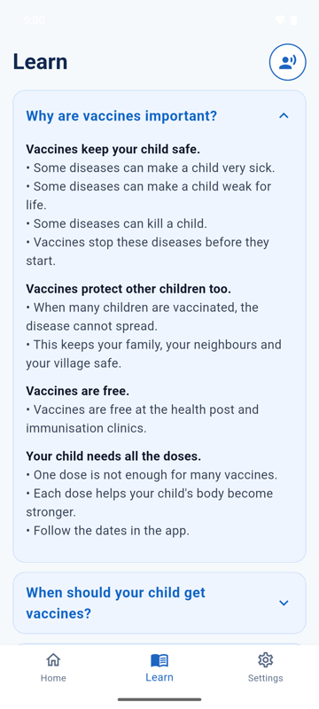
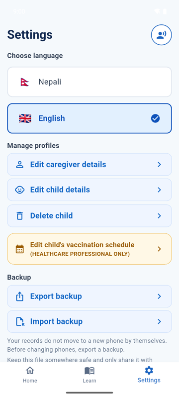
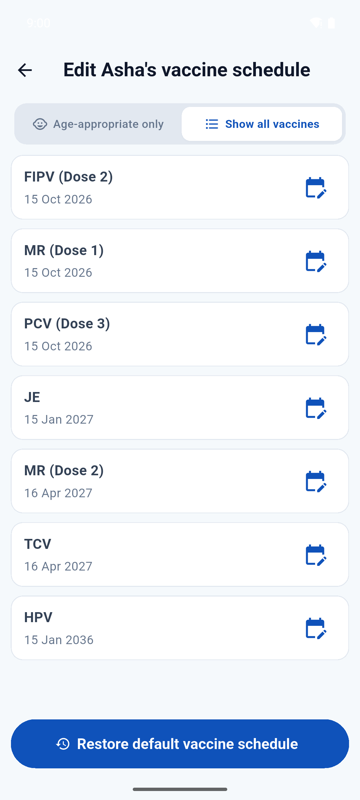

# TikaSathi

Offline childhood vaccine reminders for caregivers in Nepal. Flutter app for Android and iOS.

Built by UWA CITS3200 Group 47 with the UWA School of [Population and Global Health](https://www.uwa.edu.au/schools/population-global-health).

<p align="center">
  
  
  
</p>

## Contents

- [About](#about)
- [Features](#features)
- [Screenshots](#screenshots)
- [Tech stack](#tech-stack)
- [Set up](#set-up)
- [Build for Android](#build-for-android)
- [Build for iOS (Mac only)](#build-for-ios-mac-only)
- [Run the tests](#run-the-tests)
- [Project structure](#project-structure)
- [More docs](#more-docs)

## About

TikaSathi ("vaccine friend") helps caregivers keep track of their child's vaccines (tika) on Nepal's National Immunization Programme schedule.

- **Offline first.** No internet or account needed. All data stays on the phone, encrypted.
- **English and Nepali.** Switch language at any time.
- **Read aloud.** Most screens have a speaker button for caregivers with low literacy.

## Features

| Feature | What it does |
|---|---|
| Setup | Caregiver and child details, then tick vaccines already given. |
| Home | Every child sorted by urgency: Overdue, Due today, Due soon, Up to date. |
| Log vaccine | Record one or more doses given on a date. |
| Schedule and history | See upcoming vaccines and fix past dates. |
| Reminders | Local notifications 1 week before, 1 day before, on the day, and after a missed dose. |
| Health facility | Save the closest clinic; it appears in reminders. |
| Learn | Simple answers to common vaccine questions. |
| Backup | Export and import a backup file (JSON) to move phones. |
| Health worker editor | Change or remove scheduled vaccines for catch-up plans. |

## Screenshots

| Home | Log vaccine | Child page | Reminder |
|:---:|:---:|:---:|:---:|
|  |  |  |  |

| Setup | Learn | Settings | Health worker editor |
|:---:|:---:|:---:|:---:|
|  |  |  |  |

## Tech stack

| Area | Package |
|---|---|
| Framework | Flutter 3.44.9 (pinned with FVM) |
| State | Riverpod |
| Database | Drift + SQLCipher (encrypted SQLite) |
| Keys | flutter_secure_storage |
| Reminders | flutter_local_notifications |
| Read aloud | flutter_tts |
| Languages | Flutter l10n (English, Nepali) |

## Set up

Build from the `main` branch. Android builds on Mac or Windows. iOS builds on a Mac only.

| | Mac | Windows |
|---|---|---|
| Git | `brew install git` | [git-scm.com](https://git-scm.com) |
| FVM | `brew install fvm` | `choco install fvm` |
| Android Studio | [developer.android.com/studio](https://developer.android.com/studio) | Same, and turn on **Developer Mode** |

In Android Studio, install **Android SDK Command-line Tools** (**Settings › Android SDK › SDK Tools**). Then:

```
git clone https://github.com/uwa-spgh/cits3200-tikasathi.git
cd cits3200-tikasathi
git checkout main
fvm install
fvm flutter doctor --android-licenses
fvm flutter pub get
```

**You should see:** `fvm flutter doctor` ticks **Flutter** and **Android toolchain**.

## Build for Android

```
fvm flutter build apk --release
```

**You should see:** `build/app/outputs/flutter-apk/app-release.apk`

> [!WARNING]
> The APK is signed with a debug key. Set up a release key before publishing.

## Build for iOS (Mac only)

Install Xcode, then:

```
brew install cocoapods
cd ios && pod install && cd ..
```

Open `ios/Runner.xcworkspace` in Xcode. Under **Runner › Signing & Capabilities**, set **Team** to your own (and change the **Bundle Identifier** if Xcode says it is taken). Then:

```
fvm flutter build ipa --release
```

**You should see:** an `.ipa` in `build/ios/ipa/`. This needs a paid Apple Developer account. Install on iPhones through TestFlight or the App Store.

## Run the tests

```
fvm flutter test
```

## Project structure

```
lib/
  core/       database, reminders, NIP schedule, l10n, theme, services
  features/   one folder per screen (home, onboarding, record_dose, ...)
test/         unit and widget tests
integration_test/
docs/         specification, client documents, screenshots
```

## More docs

- Project specification: [docs/SPECIFICATION.md](docs/SPECIFICATION.md)
- Developer guide: [DEVELOPER_GUIDE.md](DEVELOPER_GUIDE.md)
- Contributing: [CONTRIBUTING.md](CONTRIBUTING.md)
- License: [LICENSE](LICENSE)
